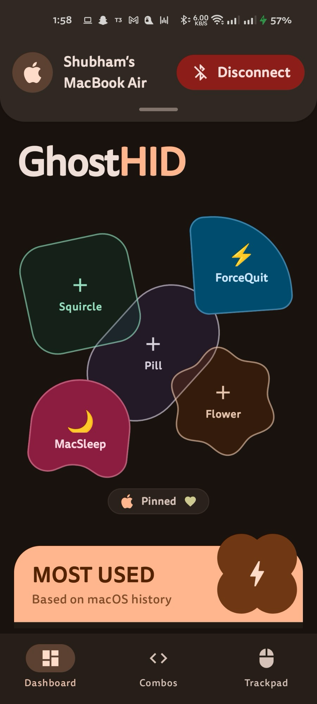
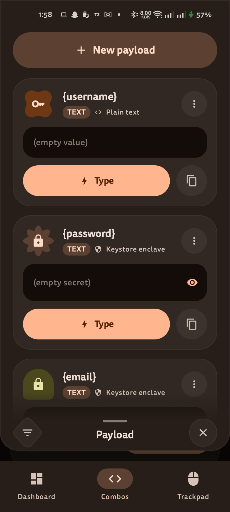

<p align="center">
  
</p>

<h1 align="center">GhostHID</h1>

<p align="center">
  Native Android Bluetooth Classic Human Interface Device (HID) controller, trackpad, raw payload injector, and full-bleed macro deck with Material 3 Expressive design.
</p>

<p align="center">
  <a href="https://apps.obtainium.imranr.dev/redirect?r=obtainium%3A//app/%7B%22id%22%3A%22com.sj010.ghid%22%2C%22url%22%3A%22https%3A//github.com/ShubhamJ010/ghost-hid%22%2C%22author%22%3A%22ShubhamJ010%22%2C%22name%22%3A%22GhostHID%22%2C%22preferredApkIndex%22%3A0%2C%22additionalSettings%22%3A%22%7B%5C%22includePrereleases%5C%22%3A%20true%2C%20%5C%22fallbackToOlderReleases%5C%22%3A%20true%2C%20%5C%22filterReleaseTitlesByRegEx%5C%22%3A%20%5C%22%5C%22%2C%20%5C%22filterReleaseNotesByRegEx%5C%22%3A%20%5C%22%5C%22%2C%20%5C%22verifyLatestTag%5C%22%3A%20false%2C%20%5C%22sortMethodChoice%5C%22%3A%20%5C%22date%5C%22%2C%20%5C%22useLatestAssetDateAsReleaseDate%5C%22%3A%20false%2C%20%5C%22releaseTitleAsVersion%5C%22%3A%20false%2C%20%5C%22trackOnly%5C%22%3A%20false%2C%20%5C%22versionExtractionRegEx%5C%22%3A%20%5C%22%5C%22%2C%20%5C%22matchGroupToUse%5C%22%3A%20%5C%22%5C%22%2C%20%5C%22versionDetection%5C%22%3A%20true%2C%20%5C%22releaseDateAsVersion%5C%22%3A%20false%2C%20%5C%22useVersionCodeAsOSVersion%5C%22%3A%20false%2C%20%5C%22apkFilterRegEx%5C%22%3A%20%5C%22ghost-hid.*%5C%5C%5C%5C.apk%5C%22%2C%20%5C%22invertAPKFilter%5C%22%3A%20false%2C%20%5C%22autoApkFilterByArch%5C%22%3A%20true%2C%20%5C%22appName%5C%22%3A%20%5C%22%5C%22%2C%20%5C%22appAuthor%5C%22%3A%20%5C%22%5C%22%2C%20%5C%22shizukuPretendToBeGooglePlay%5C%22%3A%20false%2C%20%5C%22allowInsecure%5C%22%3A%20false%2C%20%5C%22exemptFromBackgroundUpdates%5C%22%3A%20false%2C%20%5C%22skipUpdateNotifications%5C%22%3A%20false%2C%20%5C%22about%5C%22%3A%20%5C%22%5C%22%2C%20%5C%22refreshBeforeDownload%5C%22%3A%20false%2C%20%5C%22includeZips%5C%22%3A%20false%2C%20%5C%22zippedApkFilterRegEx%5C%22%3A%20%5C%22%5C%22%7D%22%2C%22overrideSource%22%3Anull%7D">
    
  </a>
  &nbsp;&nbsp;
  <a href="https://github.com/ShubhamJ010/ghost-hid/releases/tag/v0.1.1">
    
  </a>
  &nbsp;&nbsp;
  <a href="https://github.com/ShubhamJ010/ghid-cli">
    
  </a>
</p>

GhostHID turns an Android device into a physical wireless keyboard, mouse, and hardware HID injector. It connects to paired computers over native Android Bluetooth Classic HID without host drivers, companion servers, or background agents on the target computer. The connected PC or Mac identifies the phone as a standard hardware peripheral.

## Supported host platforms

GhostHID works with any host system that accepts standard Bluetooth HID input:

- Windows 10 and Windows 11
- Apple macOS
- Linux and SteamOS
- ChromeOS
- Android TV and media players

Pair once through system Bluetooth settings and start sending inputs immediately.

## Key features

- **Native Bluetooth HID.** Uses the Android `BluetoothHidDevice` API directly over L2CAP. No desktop client, agent, or background relay runs on the host machine.
- **Raw HID payload injection.** Inject arbitrary raw USB HID hex packets directly across Bluetooth L2CAP channels. Supports all 4 report descriptors: Keyboard (Report 1), Mouse (Report 2), System Control (Report 3), and Consumer Control (Report 4) with automatic length-based inference and timed hold/release semantics.
- **Material 3 Expressive UI.** Built with Jetpack Compose using the Material 3 Expressive design system, including expressive rounded polygon silhouettes, morphing device cards, and fluid motion.
- **Multi-touch trackpad and mouse.** Sends standard relative pointer reports over HID Report ID 2. Supports single-tap left click, two-finger right click, edge scrolling, and middle click gestures.
- **QuickSend and text snippets.** Type text strings, credentials, and clipboard contents directly to the active window on the host computer.
- **Combo Studio and shortcut editor.** Build and assign complex modifier combinations (Ctrl, Alt, Shift, Super/Command, and custom keys) with OS-specific glyphs for Windows, macOS, and Linux.
- **Landscape stream deck.** Rotate the phone horizontally into a full-bleed macro grid with hardware action slots, customizable button shapes, and a quick payload drawer.
- **Hardware-encrypted payload vault.** Secure login credentials and repetitive text with Android Keystore hardware-backed encryption for one-tap automated typing.
- **ADB and CLI companion.** Automate keystrokes, shortcuts, raw hex reports, and mouse clicks from terminal scripts or agent workflows using [ghid-cli](https://github.com/ShubhamJ010/ghid-cli).

## Interface overview

<p align="center">
  
</p>

<p align="center">
  
  
  
  
</p>

## Subsystems

### Raw HID payload injection
GhostHID supports direct raw HID report transmission across Bluetooth L2CAP channels without requiring intermediate keyboard scancode abstractions:
- **Report ID 1 (Keyboard)**: 8-byte USB HID keyboard reports (`[modifiers, reserved, key1, key2, key3, key4, key5, key6]`).
- **Report ID 2 (Mouse)**: 4-byte relative pointer reports (`[buttons, dx, dy, wheel]`).
- **Report ID 3 (System Control)**: 1-byte ACPI power management controls (`0x01` System Power Down, `0x02` System Sleep, `0x04` System Wake Up).
- **Report ID 4 (Consumer Control)**: 2-byte multimedia and hardware controls (`0xcd 0x00` Play/Pause, `0xe9 0x00` Volume Up, `0xea 0x00` Volume Down, `0xe2 0x00` Mute, media navigation, etc.).
- **Automatic Report ID inference & hold semantics**: Payloads automatically infer their target report ID by byte count (1 byte -> Report 3, 2 bytes -> Report 4, 4 bytes -> Report 2, 8 bytes -> Report 1) or target a custom report ID explicitly. All momentary reports support timed holds (`hold_ms` / `{TOKEN:duration}`) with automatic zero-report release to prevent stuck keys.

### Material 3 Expressive UI
The user interface uses Jetpack Compose with the Material 3 Expressive catalog (`androidx.compose.material3.MaterialShapes`). Buttons and action slots clip to distinct rounded polygon forms, including cookie, burst, clover, and arch shapes, while preserving accessibility and touch targets.

### Landscape stream deck
Rotating the phone horizontally activates Ghost Stream Deck mode. The screen switches to a full-bleed button collage with hardware action slots, custom assigned macro buttons, and an expandable payload drawer.

### Touchpad and mouse emulation
The trackpad surface sends standard relative pointer reports over HID Report ID 2. It supports single-tap left click, two-finger right click, edge scrolling, and middle click gestures.

### QuickSend and Snippet Studio
QuickSend enables rapid text injection into the active session on the host machine. Snippet Studio lets you manage recurring terminal commands, code snippets, and phrases for one-tap transmission without typing character by character.

### Combo Studio
The combo editor lets you assign custom key combinations with modifier ordering and custom icon glyphs. It detects the target operating system (Windows, macOS, or Linux) and adapts glyph display accordingly.

### Macro sequence parser
The built-in action sequence parser processes bracket syntax strings such as `{mod+s}{500ms}rustdesk{Enter}`. It translates keys into USB HID scancodes, enforces modifier key down/up order, and sequences delays.

### Secure payload vault
The expandable payload drawer stores credentials, login secrets, and repetitive strings. It uses Android Keystore hardware-backed encryption to protect sensitive data and allows one-tap typing into active HID target sessions.

### Native background service and IPC
A foreground Android service registers the native `BluetoothHidDevice` SDP profile and manages L2CAP transport channels. It exposes an IPC receiver protected by `android.permission.DUMP` so external scripts and the [ghid-cli](https://github.com/ShubhamJ010/ghid-cli) companion tool can automate keystrokes, raw payloads, combos, and mouse events over ADB without allowing unauthorized third-party apps to inject commands.

## Installation

### Method 1: Obtainium (automatic updates)
1. Install [Obtainium](https://github.com/ImranR98/Obtainium) on your Android phone.
2. Tap the badge below to add GhostHID directly:

<p align="center">
  <a href="https://apps.obtainium.imranr.dev/redirect?r=obtainium%3A//app/%7B%22id%22%3A%22com.sj010.ghid%22%2C%22url%22%3A%22https%3A//github.com/ShubhamJ010/ghost-hid%22%2C%22author%22%3A%22ShubhamJ010%22%2C%22name%22%3A%22GhostHID%22%2C%22preferredApkIndex%22%3A0%2C%22additionalSettings%22%3A%22%7B%5C%22includePrereleases%5C%22%3A%20true%2C%20%5C%22fallbackToOlderReleases%5C%22%3A%20true%2C%20%5C%22filterReleaseTitlesByRegEx%5C%22%3A%20%5C%22%5C%22%2C%20%5C%22filterReleaseNotesByRegEx%5C%22%3A%20%5C%22%5C%22%2C%20%5C%22verifyLatestTag%5C%22%3A%20false%2C%20%5C%22sortMethodChoice%5C%22%3A%20%5C%22date%5C%22%2C%20%5C%22useLatestAssetDateAsReleaseDate%5C%22%3A%20false%2C%20%5C%22releaseTitleAsVersion%5C%22%3A%20false%2C%20%5C%22trackOnly%5C%22%3A%20false%2C%20%5C%22versionExtractionRegEx%5C%22%3A%20%5C%22%5C%22%2C%20%5C%22matchGroupToUse%5C%22%3A%20%5C%22%5C%22%2C%20%5C%22versionDetection%5C%22%3A%20true%2C%20%5C%22releaseDateAsVersion%5C%22%3A%20false%2C%20%5C%22useVersionCodeAsOSVersion%5C%22%3A%20false%2C%20%5C%22apkFilterRegEx%5C%22%3A%20%5C%22ghost-hid.*%5C%5C%5C%5C.apk%5C%22%2C%20%5C%22invertAPKFilter%5C%22%3A%20false%2C%20%5C%22autoApkFilterByArch%5C%22%3A%20true%2C%20%5C%22appName%5C%22%3A%20%5C%22%5C%22%2C%20%5C%22appAuthor%5C%22%3A%20%5C%22%5C%22%2C%20%5C%22shizukuPretendToBeGooglePlay%5C%22%3A%20false%2C%20%5C%22allowInsecure%5C%22%3A%20false%2C%20%5C%22exemptFromBackgroundUpdates%5C%22%3A%20false%2C%20%5C%22skipUpdateNotifications%5C%22%3A%20false%2C%20%5C%22about%5C%22%3A%20%5C%22%5C%22%2C%20%5C%22refreshBeforeDownload%5C%22%3A%20false%2C%20%5C%22includeZips%5C%22%3A%20false%2C%20%5C%22zippedApkFilterRegEx%5C%22%3A%20%5C%22%5C%22%7D%22%2C%22overrideSource%22%3Anull%7D">
    
  </a>
</p>

### Method 2: Manual download
Download `ghost-hid.apk` from the [Releases](https://github.com/ShubhamJ010/ghost-hid/releases) page and install it with ADB or an on-device package installer:

```bash
adb install -r ghost-hid.apk
```

## Bluetooth pairing instructions

Pair the phone and target computer before triggering HID commands.

1. Open GhostHID on the phone and verify Bluetooth is enabled.
2. In Windows Settings, navigate to **Bluetooth & devices** and set **Bluetooth devices discovery** to **Advanced**.
3. Click **Add device > Bluetooth** and select your phone.
4. Confirm the numeric PIN on both devices.
5. In the GhostHID app, tap **Connect to device** next to your paired computer name.

## CLI companion

To control the phone from a terminal, scripts, or agent workflows on macOS and Linux, install [ghid-cli](https://github.com/ShubhamJ010/ghid-cli):

```bash
# Clone and build ghid-cli
git clone https://github.com/ShubhamJ010/ghid-cli.git
cd ghid-cli
go build -o ghid ./cmd/ghid

# Send commands over ADB
ghid login
ghid lock
ghid combo "ctrl+shift+esc"

# Inject raw HID reports (Consumer, System, Keyboard, Mouse)
ghid raw "e900" --hold 500ms       # Volume Up held for 500ms
ghid raw "02" --id 3               # System Sleep
ghid raw "0800040000000000" --id 1 # Win+A chord
```

## Building from source

Prerequisites: JDK 17 and Android SDK Platform 35.

```bash
git clone https://github.com/ShubhamJ010/ghost-hid.git
cd ghost-hid
./build.sh
```

The release APK is written to `build/ghost-hid.apk`.

## Documentation

Architecture specifications, wire protocols, execution flows, and Architecture Decision Records (ADRs) are indexed in the [documentation index](docs/README.md).

## License

MIT
