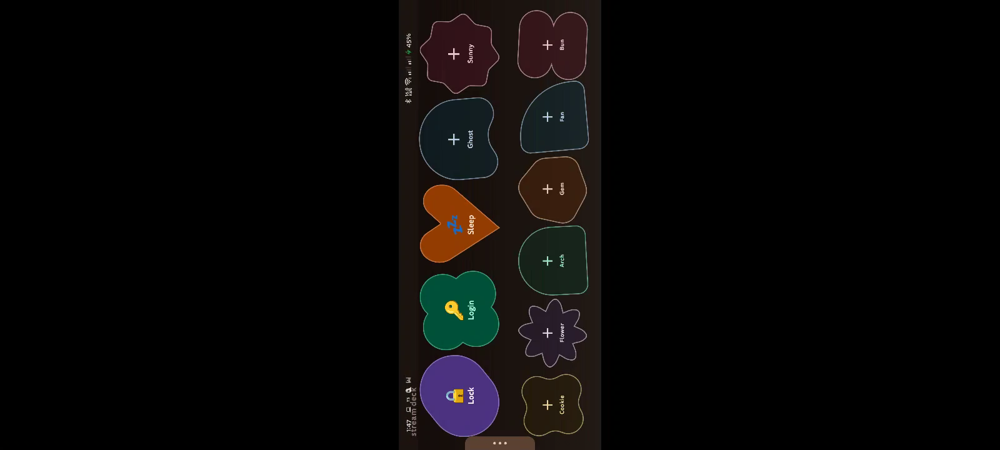
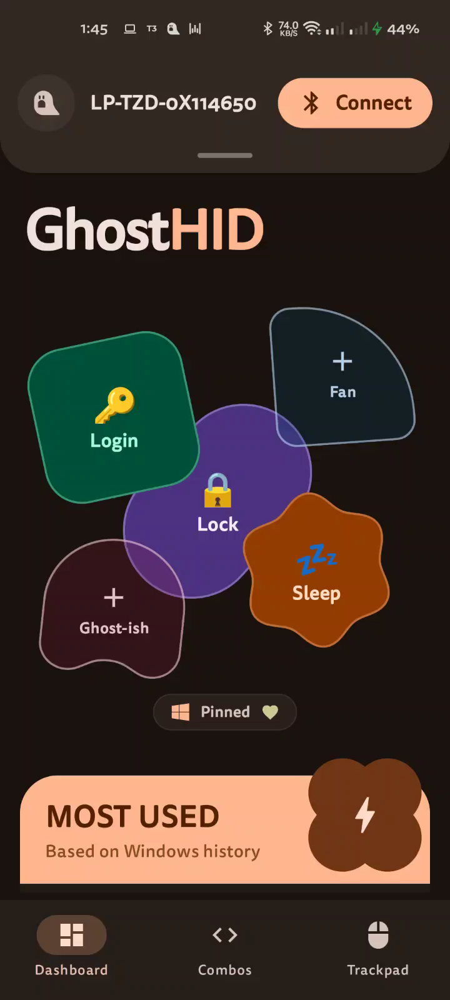
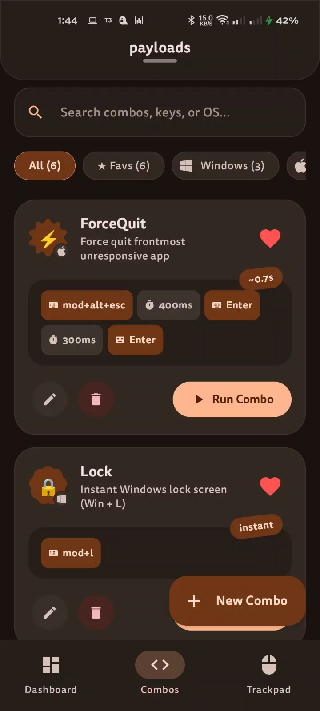
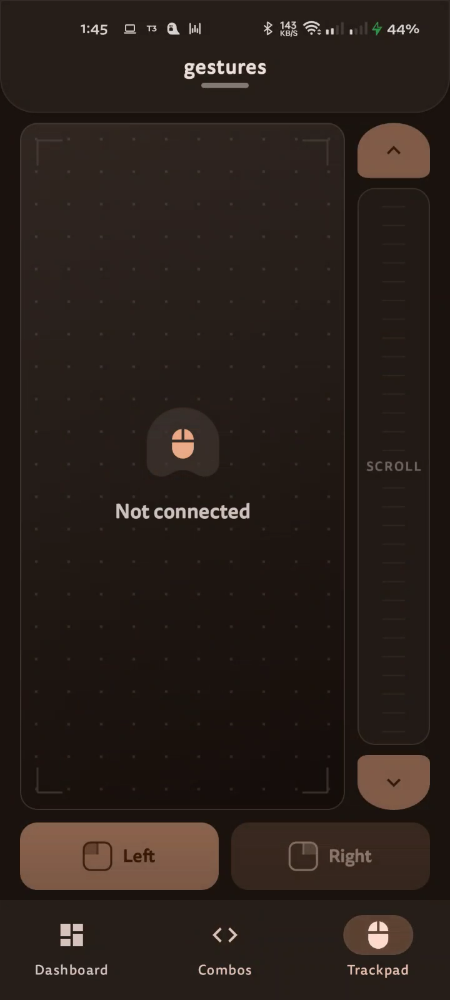

<p align="center">
  
</p>

<h1 align="center">GhostHID</h1>

<p align="center">
  Android Bluetooth Classic Human Interface Device (HID) controller, trackpad, and full-bleed macro deck.
</p>

<p align="center">
  <a href="https://apps.obtainium.imranr.dev/redirect?r=obtainium%3A//app/%7B%22id%22%3A%22com.sj010.ghid%22%2C%22url%22%3A%22https%3A//github.com/ShubhamJ010/ghost-hid%22%2C%22author%22%3A%22ShubhamJ010%22%2C%22name%22%3A%22GhostHID%22%2C%22preferredApkIndex%22%3A0%2C%22additionalSettings%22%3A%22%7B%5C%22includePrereleases%5C%22%3A%20true%2C%20%5C%22fallbackToOlderReleases%5C%22%3A%20true%2C%20%5C%22filterReleaseTitlesByRegEx%5C%22%3A%20%5C%22%5C%22%2C%20%5C%22filterReleaseNotesByRegEx%5C%22%3A%20%5C%22%5C%22%2C%20%5C%22verifyLatestTag%5C%22%3A%20false%2C%20%5C%22sortMethodChoice%5C%22%3A%20%5C%22date%5C%22%2C%20%5C%22useLatestAssetDateAsReleaseDate%5C%22%3A%20false%2C%20%5C%22releaseTitleAsVersion%5C%22%3A%20false%2C%20%5C%22trackOnly%5C%22%3A%20false%2C%20%5C%22versionExtractionRegEx%5C%22%3A%20%5C%22%5C%22%2C%20%5C%22matchGroupToUse%5C%22%3A%20%5C%22%5C%22%2C%20%5C%22versionDetection%5C%22%3A%20true%2C%20%5C%22releaseDateAsVersion%5C%22%3A%20false%2C%20%5C%22useVersionCodeAsOSVersion%5C%22%3A%20false%2C%20%5C%22apkFilterRegEx%5C%22%3A%20%5C%22ghost-hid.*%5C%5C%5C%5C.apk%5C%22%2C%20%5C%22invertAPKFilter%5C%22%3A%20false%2C%20%5C%22autoApkFilterByArch%5C%22%3A%20true%2C%20%5C%22appName%5C%22%3A%20%5C%22%5C%22%2C%20%5C%22appAuthor%5C%22%3A%20%5C%22%5C%22%2C%20%5C%22shizukuPretendToBeGooglePlay%5C%22%3A%20false%2C%20%5C%22allowInsecure%5C%22%3A%20false%2C%20%5C%22exemptFromBackgroundUpdates%5C%22%3A%20false%2C%20%5C%22skipUpdateNotifications%5C%22%3A%20false%2C%20%5C%22about%5C%22%3A%20%5C%22%5C%22%2C%20%5C%22refreshBeforeDownload%5C%22%3A%20false%2C%20%5C%22includeZips%5C%22%3A%20false%2C%20%5C%22zippedApkFilterRegEx%5C%22%3A%20%5C%22%5C%22%7D%22%2C%22overrideSource%22%3Anull%7D">
    
  </a>
  &nbsp;&nbsp;
  <a href="https://github.com/ShubhamJ010/ghost-hid/releases/tag/v0.1.0">
    
  </a>
  &nbsp;&nbsp;
  <a href="https://github.com/ShubhamJ010/ghid-cli">
    
  </a>
</p>

GhostHID turns an Android device into a physical wireless keyboard and mouse. It connects to paired computers over Bluetooth Classic HID without host drivers or companion software. The target computer identifies the phone as a standard USB/Bluetooth peripheral.

## Interface overview

<p align="center">
  
</p>

<p align="center">
  
  
  
</p>

## Subsystems

### Landscape stream deck
Rotating the phone horizontally activates Ghost Stream Deck mode. The screen switches to a full-bleed button collage with hardware action slots, custom assigned macro buttons, and an expandable payload drawer.

### Touchpad and mouse emulation
The trackpad surface sends standard relative pointer reports over HID Report ID 2. It supports single-tap left click, two-finger right click, edge scrolling, and middle click gestures.

### Macro sequence parser
The built-in action sequence parser processes bracket syntax strings such as `{mod+s}{500ms}rustdesk{Enter}`. It translates keys into USB HID scancodes, enforces modifier key down/up order, and sequences delays.

### Background service and IPC
A foreground Android service registers the `BluetoothHidDevice` SDP profile and manages L2CAP transport channels. It exposes a broadcast receiver interface so external scripts and the [ghid-cli](https://github.com/ShubhamJ010/ghid-cli) companion tool can automate keystrokes, combos, and mouse events over ADB.

## Installation

### Method 1: Obtainium (automatic updates)
1. Install [Obtainium](https://github.com/ImranR98/Obtainium) on your Android phone.
2. Tap the badge below to add GhostHID directly:

<p align="center">
  <a href="https://apps.obtainium.imranr.dev/redirect?r=obtainium%3A//app/%7B%22id%22%3A%22com.sj010.ghid%22%2C%22url%22%3A%22https%3A//github.com/ShubhamJ010/ghost-hid%22%2C%22author%22%3A%22ShubhamJ010%22%2C%22name%22%3A%22GhostHID%22%2C%22preferredApkIndex%22%3A0%2C%22additionalSettings%22%3A%22%7B%5C%22includePrereleases%5C%22%3A%20true%2C%20%5C%22fallbackToOlderReleases%5C%22%3A%20true%2C%20%5C%22filterReleaseTitlesByRegEx%5C%22%3A%20%5C%22%5C%22%2C%20%5C%22filterReleaseNotesByRegEx%5C%22%3A%20%5C%22%5C%22%2C%20%5C%22verifyLatestTag%5C%22%3A%20false%2C%20%5C%22sortMethodChoice%5C%22%3A%20%5C%22date%5C%22%2C%20%5C%22useLatestAssetDateAsReleaseDate%5C%22%3A%20false%2C%20%5C%22releaseTitleAsVersion%5C%22%3A%20false%2C%20%5C%22trackOnly%5C%22%3A%20false%2C%20%5C%22versionExtractionRegEx%5C%22%3A%20%5C%22%5C%22%2C%20%5C%22matchGroupToUse%5C%22%3A%20%5C%22%5C%22%2C%20%5C%22versionDetection%5C%22%3A%20true%2C%20%5C%22releaseDateAsVersion%5C%22%3A%20false%2C%20%5C%22useVersionCodeAsOSVersion%5C%22%3A%20false%2C%20%5C%22apkFilterRegEx%5C%22%3A%20%5C%22ghost-hid.*%5C%5C%5C%5C.apk%5C%22%2C%20%5C%22invertAPKFilter%5C%22%3A%20false%2C%20%5C%22autoApkFilterByArch%5C%22%3A%20true%2C%20%5C%22appName%5C%22%3A%20%5C%22%5C%22%2C%20%5C%22appAuthor%5C%22%3A%20%5C%22%5C%22%2C%20%5C%22shizukuPretendToBeGooglePlay%5C%22%3A%20false%2C%20%5C%22allowInsecure%5C%22%3A%20false%2C%20%5C%22exemptFromBackgroundUpdates%5C%22%3A%20false%2C%20%5C%22skipUpdateNotifications%5C%22%3A%20false%2C%20%5C%22about%5C%22%3A%20%5C%22%5C%22%2C%20%5C%22refreshBeforeDownload%5C%22%3A%20false%2C%20%5C%22includeZips%5C%22%3A%20false%2C%20%5C%22zippedApkFilterRegEx%5C%22%3A%20%5C%22%5C%22%7D%22%2C%22overrideSource%22%3Anull%7D">
    
  </a>
</p>

### Method 2: Manual download
Download `ghost-hid.apk` from the [Releases](https://github.com/ShubhamJ010/ghost-hid/releases) page and install it with ADB or an on-device package installer:

```bash
adb install -r ghost-hid.apk
```

## Bluetooth pairing instructions

Pair the phone and target computer before triggering HID commands.

1. Open GhostHID on the phone and verify Bluetooth is enabled.
2. In Windows Settings, navigate to **Bluetooth & devices** and set **Bluetooth devices discovery** to **Advanced**.
3. Click **Add device > Bluetooth** and select your phone.
4. Confirm the numeric PIN on both devices.
5. In the GhostHID app, tap **Connect to device** next to your paired computer name.

## CLI companion

To control the phone from a terminal, scripts, or agent workflows on macOS and Linux, install [ghid-cli](https://github.com/ShubhamJ010/ghid-cli):

```bash
# Clone and build ghid-cli
git clone https://github.com/ShubhamJ010/ghid-cli.git
cd ghid-cli
go build -o ghid ./cmd/ghid

# Send commands over ADB
ghid login
ghid lock
ghid combo "ctrl+shift+esc"
```

## Building from source

Prerequisites: JDK 17 and Android SDK Platform 35.

```bash
git clone https://github.com/ShubhamJ010/ghost-hid.git
cd ghost-hid
./build.sh
```

The release APK is written to `build/ghost-hid.apk`.

## License

MIT
