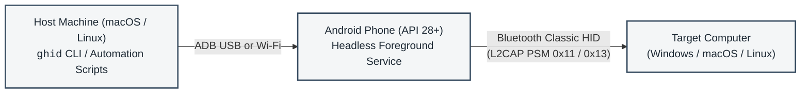

# GhostHID

Headless Android Bluetooth HID controller and automation gateway.

GhostHID turns an Android phone into a physical Bluetooth Human Interface Device (HID) composite peripheral. It injects keyboard keystrokes, pointer gestures, text strings, and automated login sequences into any paired Windows, macOS, or Linux computer.

The phone runs a background Android service controlled locally or over Wi-Fi via ADB and the `ghid` command-line utility.



## Why GhostHID?

macOS does not support the Bluetooth HID Peripheral role. A Mac can connect to external keyboards and mice as a host, but it cannot advertise itself as a Bluetooth input device to control another computer.

Android 9+ (API 28+) supports the native Bluetooth HID Device profile (`BluetoothHidDevice`). GhostHID uses an Android device as an ADB-driven transport bridge. You control the Android phone from your Mac over USB or Wi-Fi using ADB, and the phone connects to your target machine (such as a Windows laptop) as a standard Bluetooth keyboard and mouse. The target system requires no custom software, drivers, or agent daemons. It sees only a standard wireless HID peripheral.

### Agent and automation design

GhostHID is built for headless operation and AI agents:
- Every command supports `--json` with structured schemas and machine-readable output.
- Scripting invocations disable interactive prompts, confirmations, and terminal alternate screens.
- Deterministic exit codes allow scripts and agents to distinguish connection errors from syntax or device errors.
- Low-latency keystroke injection, combo sequences, and raw HID reports allow autonomous agents to operate target computers without accessibility APIs or screen-scraping hooks.

## Documentation Index

- [System Architecture Specification](docs/architecture.md): Subsystem topology, Android foreground service lifecycle, dual-report HID descriptor bytecode, and security model.
- [Execution and Lifecycle Flows](docs/flows.md): Sequence diagrams for automated login, combo execution, Bluetooth SDP handshakes, ACPI sleep teardown, and diagnostic health checks.
- [Wire and Report Protocol Specification](docs/protocol-spec.md): Binary report payloads, L2CAP channels, USB HID scancode translation table, and ADB intent extras.
- [Troubleshooting and Operational Runbook](docs/troubleshooting.md): Step-by-step diagnosis for ADB transport drops, Windows audio-vs-HID driver binding, Bluetooth state desync, and macOS Keychain in SSH.
- [Automation and Agent Integration Guide](docs/agent-integration.md): Machine-readable `--json` schemas, exit code definitions, and integration recipes for Bash, Python, and Node.js.
- [Standalone Android Toolchain (Zero Gradle)](docs/build-and-toolchain.md): Technical breakdown of the 1.8-second APK compilation pipeline using `aapt2`, `javac`, `d8`, `zipalign`, and `apksigner`.
- [Architecture Decision Records](docs/decisions/):
  - [ADR-001: Headless Android Service with BroadcastReceiver IPC over ADB](docs/decisions/ADR-001-headless-android-service-adb-ipc.md)
  - [ADR-002: Dual-Report HID Descriptor for Keyboard and Mouse](docs/decisions/ADR-002-dual-report-descriptor-for-keyboard-and-mouse.md)
  - [ADR-003: Charm TUI with Structured JSON API and Native Credential Vault](docs/decisions/ADR-003-charm-tui-with-json-agent-api-and-keychain-vault.md)
  - [ADR-004: Snippets Subsystem, Dynamic Combo Variables, and Unified Quick Send](docs/decisions/ADR-004-snippets-subsystem-and-quick-send.md)

## Quick Start

### 1. Install the CLI
Link `ghid` into your path (`~/.local/bin`) and register the UNIX manual page:

```bash
./ghid install-bin
```

Verify the installation:
```bash
which ghid
# /Users/sj/.local/bin/ghid

man ghid
```

To remove the symlink and man page later:
```bash
ghid uninstall-bin
```

### 2. Connect Your Phone via ADB
Enable Developer Options and USB Debugging on your Android phone. Connect via USB or Wi-Fi:

```bash
# Connect over Wi-Fi (if wireless debugging is enabled on phone)
adb connect 192.168.1.80:41839
```

### 3. Build and Install the Phone APK
The build script compiles directly with Android SDK tools (`aapt2`, `javac`, `d8`, `zipalign`, `apksigner`) without Gradle:

```bash
./build.sh
ghid install-apk
```

### 4. Pair Phone to Target Computer
Pair the phone and target computer over Bluetooth before first use. See [Bluetooth Pairing Setup](#bluetooth-pairing-setup) for the required Windows settings.

> [!NOTE]
> **Wake-on-Bluetooth limitation**
> During ACPI sleep states (Modern Standby, S3, or S4 hibernating), internal Bluetooth controllers on most PC laptops are powered down and cannot receive incoming Bluetooth packets.
>
> Tap any physical key or press the power button on the target laptop to power on its Bluetooth controller before connecting via `ghid`.

## Interactive Console

Running `ghid` without arguments opens the full-screen terminal console:

```bash
ghid
```

### Startup Diagnostics
On startup, `ghid` runs through environment checks:
1. Checks for connected USB or wireless ADB devices. If disconnected, an interactive menu allows entering custom IP addresses, ports, or pairing codes.
2. Checks whether package `com.sj010.ghid_headless` is installed. Offers to install pre-built APK or compile from source.
3. Checks whether phone Bluetooth is enabled.
4. Starts the Android foreground service and waits for SDP profile registration.
5. Connects Bluetooth to the active target computer.

### Main Menu Interface
```text
┌────────────────────────────────────────────────────────┐
  Phone Device:    KB2001 (192.168.1.80:41839)
  Gateway HID:     READY
  Target Laptop:   LP-TZD-0X114650 [38:FC:98:E8:E3:87] -> ● CONNECTED
  Cached Login:    Administrator
└────────────────────────────────────────────────────────┘
Actions:
  [1] login      - Automated Windows unlock & login
  [2] lock       - Lock Windows screen (Win + L)
  [3] sleep      - Windows Sleep sequence + countdown exit
  [4] type       - Inject text string via keyboard
  [5] combo      - Combo Studio (create / send / delete Windows combos)
  [6] raw        - Inject raw 16-hex byte HID report
  [7] creds      - View / update cached login credentials
  [d] devices    - Registered target devices & pair new laptop/Mac
  [8] reconnect  - Re-trigger Bluetooth connection
  [9] doctor     - Run full hardware & gateway diagnostic check
  [0] exit       - Disconnect Bluetooth & terminate phone service
```

- `login`: Wakes screen (`Ctrl+Alt+Del` then `Esc`), types username and password from the Keychain vault, and presses `Enter`.
- `lock`: Dispatches `Win + L` immediately.
- `sleep`: Dispatches Windows sleep sequence (`Win + X`, then `u`, then `s`), counts down 5 seconds, disconnects Bluetooth, and terminates the Android foreground service.
- `type`: Sends raw text strings as a sequence of keystrokes.
- `combo`: Opens the interactive Combo Studio.
- `raw`: Sends explicit 8-byte raw hex reports directly to the HID driver.
- `devices`: Manages target device list and active selection.
- `creds`: Displays or updates credentials stored in the macOS Keychain.
- `doctor`: Runs full diagnostic checks on ADB, APK, Bluetooth, and Keychain.
- `exit`: Disconnects Bluetooth and terminates phone service to conserve battery.

## Command-Line Usage and Automation API

All commands support `--json` for scripts, CI jobs, and AI agents. In JSON mode, interactive prompts are disabled, actions proceed without confirmation, and errors return exit code 1 with JSON error bodies.

### System Diagnostics (`doctor`)
Checks ADB, Android package status, Bluetooth state, SDP registration, target connection, and Keychain storage:

```bash
ghid doctor --json
```

Example output:
```json
{
  "version": "1.0.0",
  "adb_path": "/opt/homebrew/bin/adb",
  "adb_available": true,
  "device_connected": true,
  "device_model": "KB2001",
  "device_serial": "192.168.1.80:41839",
  "apk_installed": true,
  "bluetooth_on": true,
  "gateway_registered": true,
  "gateway_connected": true,
  "target_laptop": "LP-TZD-0X114650",
  "target_address": "38:FC:98:E8:E3:87",
  "registered_devices": 1,
  "keychain_available": true,
  "cached_user": "Administrator",
  "has_cached_password": true,
  "checks": [
    {"name": "ADB Host Binary", "pass": true, "detail": "/opt/homebrew/bin/adb"},
    {"name": "Device Transport", "pass": true, "detail": "KB2001 (192.168.1.80:41839)"},
    {"name": "Gateway Package", "pass": true, "detail": "com.sj010.ghid_headless installed"},
    {"name": "Phone Bluetooth Radio", "pass": true, "detail": "Radio active"},
    {"name": "HID SDP Registration", "pass": true, "detail": "SDP registered"},
    {"name": "Host Connection", "pass": true, "detail": "Connected to LP-TZD-0X114650"},
    {"name": "macOS Keychain Vault", "pass": true, "detail": "Vault accessible, user Administrator cached"}
  ]
}
```

### Connection Status (`status`)
Inspects active connection state:

```bash
ghid status --json
```

Returns exit code 0 if connected, 1 if disconnected.

### Automated Login (`login`)
Unlock using stored Keychain credentials:
```bash
ghid login
```

Specify credentials and save them to Keychain for subsequent runs:
```bash
ghid login -u "Administrator" -p "SecretPassword123" --save
```

### Screen Lock and Sleep (`lock`, `sleep`)
```bash
# Immediate screen lock (Win + L)
ghid lock

# Sleep sequence with 5-second countdown and zero-battery exit
ghid sleep --countdown 5
```

### Quick Send: Keystroke Typing and Raw Reports (`quick`)
Unified entry point for ad-hoc text typing and raw HID hex reports:

```bash
# Type text through the virtual keyboard (default)
ghid quick "git status"
ghid quick "Administrator" --json

# Transmit raw 8-byte HID report (16 hex chars)
ghid quick --raw "08000f0000000000"
ghid quick "raw:08000f0000000000" --json
```

### Combo Macros and Mouse Gestures (`combo`)
```bash
# One-shot keyboard combos
ghid combo "win+r"
ghid combo "ctrl+shift+esc"

# One-shot mouse gestures (uses HID Report ID 2)
ghid combo mouse click-left
ghid combo mouse click-right
ghid combo mouse click-middle
ghid combo mouse double-click
ghid combo mouse scroll-up
ghid combo mouse scroll-down
```

### Combo Management and Scripting API
Combos can be validated, saved, listed, and sent via CLI or JSON without loading the TUI:

```bash
# Inspect accepted grammar tokens and mouse actions
ghid combo schema --json

# Validate a chained sequence before saving
ghid combo validate "win+s ->{0.7} type:rustdesk ->{0.4} enter" --json

# Save a named combo (updates if already exists)
ghid combo save "Open RustDesk" "win+s ->{0.7} type:rustdesk ->{0.4} enter" --json

# List saved combos
ghid combo list --json

# Send a saved combo by name
ghid combo send "Open RustDesk" --json

# Delete a saved combo
ghid combo delete "Open RustDesk" --json
```

Saved combos are stored in `~/.config/ghid/combos.json`.

### Target Device Management (`devices`)
Manage multiple target computers (for example, switching between a work laptop and a home Mac):

```bash
# List all registered devices
ghid devices list --json

# Add a target device and set it as active
ghid devices add --name "MacBook Pro M3" --addr "F8:FF:C2:11:22:33" --os macos --select

# Switch connection to a different device by ID or address
ghid devices select "dev-1"
ghid devices select "38:FC:98:E8:E3:87"

# Unregister a target device
ghid devices delete "F8:FF:C2:11:22:33" -f
```

Device profiles are stored in `~/.config/ghid/config.json`.

### Credential Vault (`creds`)
Inspect or clear passwords stored in macOS Keychain (`ghost-hid` service):

```bash
# View cached user status
ghid creds status --json

# Save user and password manually
ghid creds set -u "Administrator" -p "SecretPassword123"

# Clear cached credentials
ghid creds clear
```

### Log Viewing (`logs`, `tail`, `filelog`)
```bash
# View last 50 logcat messages from phone gateway
ghid logs -n 50

# Live stream logcat output
ghid tail

# Print full persistent log file from phone storage
ghid filelog
```

## Combo Sequence Grammar

Chained sequences separate steps with `->` and optional delay values in curly braces (`->{seconds}`):

```text
<step> [->{delay}] <step> [->{delay}] ...
```

Examples:
- `win+r ->{0.5} type:notepad ->{0.3} enter`
- `ctrl+alt+del ->{1.0} esc`
- `click-right ->{0.2} down ->{0.1} enter`

### Token Reference

| Type | Allowed Tokens |
|:-----|:---------------|
| Modifiers | `win`, `gui`, `ctrl`, `control`, `alt`, `shift` |
| Alphabet / Numbers | `a` through `z`, `0` through `9` |
| Function Keys | `f1` through `f12` |
| Navigation | `up`, `down`, `left`, `right`, `home`, `end`, `pgup`, `pgdn` |
| Editing & System | `enter`, `esc`, `tab`, `space`, `backspace`, `del`, `insert`, `capslock`, `numlock`, `scrolllock`, `printscreen`, `pause`, `menu` |
| Symbols | `minus`, `equal`, `leftbracket`, `rightbracket`, `backslash`, `semicolon`, `quote`, `grave`, `comma`, `period`, `slash` |
| Mouse Actions | `click-left`, `click-right`, `click-middle`, `double-click`, `scroll-up`, `scroll-down` |
| Literal Text | `type:word` or `type:"string with spaces"` |

macOS-specific key aliases (`cmd`, `option`, `opt`, `super`) are rejected by the validator to prevent ambiguous keycode mappings.

## Bluetooth Pairing Setup

To ensure Windows binds the phone as a Bluetooth HID keyboard rather than an audio device:

1. **Clear Existing Pairings:**
   - On Windows: Go to **Settings > Bluetooth & devices**. Under **Devices**, find the phone and select **Remove device**.
   - On Phone: Run `ghid unpair`.
2. **Start Phone HID Service:**
   - Run `ghid start` and ensure `ghid status --json` returns `"registered": true`.
3. **Set Discovery Mode on Windows:**
   - In Windows **Settings > Bluetooth & devices**, scroll down to **Bluetooth devices discovery** and select **Advanced**.
4. **Initiate Pairing from Windows:**
   - Click **Add device > Bluetooth**.
   - Select the phone when it appears in the device list.
   - Confirm the numeric passkey on both Windows and the phone.
   - Once paired, Windows binds the Bluetooth HID Keyboard and Mouse drivers.

## Building from Source

### Android APK

Prerequisites:
- OpenJDK 17
- Android SDK command-line tools (`aapt2`, `d8`, `zipalign`, `apksigner`)
- Android target platform android-34 (`platforms/android-34/android.jar`)

Build the APK:
```bash
./build.sh
```

Install to connected phone:
```bash
ghid install-apk
```

### CLI Binary (`ghid`)

Prerequisites:
- Go 1.21+

Build the binary:
```bash
go build -o ghid ./cmd/ghid
```
