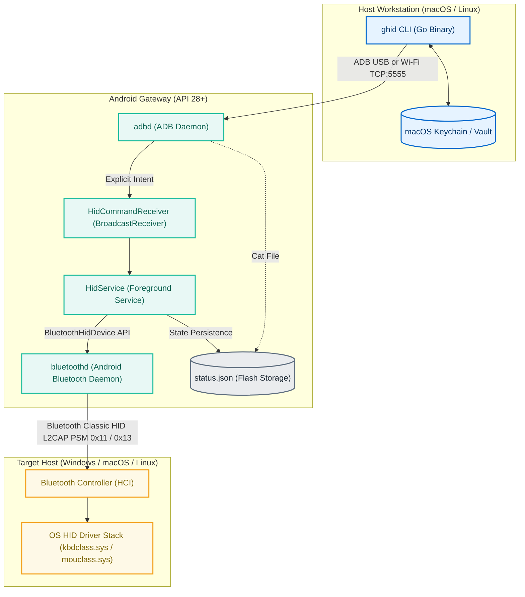

# GhostHID Architecture Specification

GhostHID turns an Android smartphone into a hardware Bluetooth Human Interface Device (HID) peripheral. It allows a host workstation or automation agent to inject keystrokes, pointer gestures, and credential sequences into a target computer.

## System Topology

The system comprises three physical or logical tiers:
1. **Host Workstation:** Runs the Go CLI (`ghid`), automation scripts, or AI agent workloads.
2. **Android Gateway Phone:** Runs the headless `com.sj010.ghid_headless` foreground service and handles Bluetooth HID profile communications.
3. **Target Computer:** Any computer running Windows, macOS, or Linux paired with the phone over Bluetooth Classic.



## Android Gateway Subsystem

The Android package `com.sj010.ghid_headless` runs headlessly without a permanent graphical activity.

### Service Lifecycle and Notification Channel
The gateway implements `android.app.Service` as an ongoing foreground service:
- **Notification Channel:** ID `ghost_hid_gateway` with `IMPORTANCE_LOW` priority.
- **Notification:** ID `1001` with ongoing status message displaying the active connection target.
- **Process Survival:** Android's low-memory killer preserves foreground services with ongoing notifications during periods of low system memory.

### Bluetooth HID Device Profile Registration
`HidService` binds the system Bluetooth HID profile proxy through `BluetoothAdapter.getProfileProxy(Context, ServiceListener, BluetoothProfile.HID_DEVICE)`:
1. When `onServiceConnected` fires, the service casts the proxy to `android.bluetooth.BluetoothHidDevice`.
2. The service registers an SDP record with `BluetoothHidDeviceAppSdpSettings`:
   - Application Name: `GhostHID Keyboard & Mouse`
   - Description: `Virtual HID Keyboard + Mouse Gateway`
   - Provider: `Android`
   - Subclass: `BluetoothHidDevice.SUBCLASS1_COMBO` (0x50)
   - Descriptor: Dual-report binary descriptor (Report ID 1 keyboard, Report ID 2 mouse).
3. The registration callback sets `mIsRegistered = true` and updates `status.json`.

### HID Descriptor Structure

The custom HID descriptor contains two top-level application collections:

#### 1. Mouse Collection (Report ID 2)
```text
Usage Page: Generic Desktop (0x01)
Usage: Mouse (0x02)
Collection: Application (0x01)
  Report ID: 2
  Usage: Pointer (0x01)
  Collection: Physical (0x00)
    Usage Page: Buttons (0x09)
    Usage Minimum: 1, Usage Maximum: 3
    Logical Minimum: 0, Logical Maximum: 1
    Report Count: 3, Report Size: 1 bit  -> Button 1 (Left), Button 2 (Right), Button 3 (Middle)
    Input (Data, Variable, Absolute)
    Report Count: 1, Report Size: 5 bits -> Constant padding bits (0x00)
    Input (Constant)
    Usage Page: Generic Desktop (0x01)
    Usage: X (0x30), Usage: Y (0x31), Usage: Wheel (0x38)
    Logical Minimum: -127, Logical Maximum: 127
    Report Size: 8 bits, Report Count: 3
    Input (Data, Variable, Relative)     -> 1 byte dX, 1 byte dY, 1 byte dWheel
  End Collection (Physical)
End Collection (Application)
```
Total mouse report size: 4 bytes.
- Byte 0: Button mask (Bit 0 = Left, Bit 1 = Right, Bit 2 = Middle).
- Byte 1: Relative X displacement (-127 to +127).
- Byte 2: Relative Y displacement (-127 to +127).
- Byte 3: Relative scroll wheel ticks (-127 to +127).

#### 2. Keyboard Collection (Report ID 1)
```text
Usage Page: Generic Desktop (0x01)
Usage: Keyboard (0x06)
Collection: Application (0x01)
  Report ID: 1
  Usage Page: Key Codes (0x07)
  Usage Minimum: 224 (0xE0), Usage Maximum: 231 (0xE7)
  Logical Minimum: 0, Logical Maximum: 1
  Report Size: 1 bit, Report Count: 8
  Input (Data, Variable, Absolute)       -> Modifier bitmap (Ctrl, Shift, Alt, GUI)
  Report Size: 8 bits, Report Count: 1
  Input (Constant)                       -> Reserved padding byte (0x00)
  Usage Page: LEDs (0x08)
  Usage Minimum: 1, Usage Maximum: 5
  Report Count: 5, Report Size: 1 bit
  Output (Data, Variable, Absolute)      -> LED indicators (Num, Caps, Scroll, Compose, Kana)
  Report Count: 1, Report Size: 3 bits
  Output (Constant)                      -> LED padding bits
  Usage Page: Key Codes (0x07)
  Usage Minimum: 0, Usage Maximum: 101
  Logical Minimum: 0, Logical Maximum: 101
  Report Size: 8 bits, Report Count: 6
  Input (Data, Array)                    -> 6 simultaneous pressed keycodes
End Collection (Application)
```
Total keyboard input report size: 8 bytes.
- Byte 0: Modifiers (Bit 0: Left Ctrl, Bit 1: Left Shift, Bit 2: Left Alt, Bit 3: Left GUI/Win, Bit 4: Right Ctrl, Bit 5: Right Shift, Bit 6: Right Alt, Bit 7: Right GUI).
- Byte 1: Reserved (0x00).
- Bytes 2-7: Up to 6 simultaneous HID usage codes.

### ADB IPC and Intent Routing
The Android application defines `HidCommandReceiver` in `AndroidManifest.xml` with `exported="true"`.
The host triggers actions by sending broadcast intents through ADB:

```bash
adb shell am broadcast \
  -a com.sj010.ghid_headless.ACTION_CMD \
  -n com.sj010.ghid_headless/.HidCommandReceiver \
  --es cmd "<action>" \
  [--es <param> "<value>"]
```

Supported intent actions and parameters:
| Intent Command (`--es cmd`) | Extra Parameter | Description |
|:----------------------------|:----------------|:------------|
| `connect` | `--es address <MAC>` | Initiates Bluetooth L2CAP connection to target host |
| `disconnect` | none | Closes Bluetooth connection |
| `unpair` | `--es address <MAC>` | Invokes hidden `removeBond` reflection on bonded device |
| `register` | none | Re-registers the Bluetooth SDP application record |
| `lock` | none | Dispatches `Win + L` keyboard sequence |
| `type` | `--es text "<string>"` | Translates ASCII characters into down/up report pairs |
| `combo` | `--es keys "<tokens>"` | Parses chord tokens and dispatches timed reports |
| `mouse` | `--es action "<token>"` | Emits mouse button or wheel reports (Report ID 2) |
| `raw` | `--es hex "<16-hex-chars>"`| Sends an explicit 8-byte raw HID report |
| `status` | none | Forces immediate write of current status to flash |
| `stop` | none | Cleans up connections, unregisters SDP, and kills service |

### State Persistence Protocol
The service writes status snapshots to `/sdcard/Android/data/com.sj010.ghid_headless/files/status.json` whenever connection, pairing, or registration state changes:

```json
{
  "registered": true,
  "connected": true,
  "state": "CONNECTED",
  "target": "LP-TZD-0X114650",
  "address": "38:FC:98:E8:E3:87",
  "updated": "2026-03-28 14:15:22.104"
}
```

The host CLI inspects this file with `adb shell cat <path>` to verify readiness before dispatching keystrokes.

---

## Host CLI Subsystem (`ghid`)

The host CLI is implemented in Go as a static binary. The codebase uses deep module boundaries with clear separation between interface, business logic, and transport execution.

```mermaid
flowchart TD
    subgraph UI_Layer["Presentation Layer"]
        CLIHandler["cli.App (Command Router)"]
        InteractiveTUI["tui.Model (Bubble Tea / Lip Gloss)"]
        ComboStudio["tui.ComboStudio (Interactive Macro Editor)"]
        SnippetStudio["tui.SnippetStudio (Variable & Secret Vault)"]
        QuickSendView["tui.QuickSend (Type / Raw Modal)"]
        JSONFormatter["JSON Output Serializer"]
    end

    subgraph Core_Logic["Core Gateway & Domain Layer"]
        GatewayCtrl["gateway.Controller Interface"]
        GatewayImpl["gateway.Gateway"]
        HIDEngine["hid.Actions & AST Parser (Variable Interpolation)"]
        ComboStore["combos.Store (~/.config/ghid/combos.json)"]
        SnippetStore["snippets.Store (~/.config/ghid/snippets.json)"]
        ConfigStore["config.Store (~/.config/ghid/config.json)"]
        Vault["vault.Vault (macOS Keychain / In-Memory)"]
    end

    subgraph Transport_Layer["Transport & System Execution Layer"]
        ADBManager["adb.Manager"]
        Runner["adb.Runner Interface (ExecRunner)"]
        NativeKeychain["keychain.MacOSKeychain (/usr/bin/security)"]
        SubprocessOS["os/exec (Local Shell Execution)"]
    end

    CLIHandler --> InteractiveTUI
    CLIHandler --> ComboStudio
    CLIHandler --> SnippetStudio
    CLIHandler --> JSONFormatter

    InteractiveTUI --> ComboStudio
    InteractiveTUI --> SnippetStudio
    InteractiveTUI --> QuickSendView

    CLIHandler --> GatewayCtrl
    InteractiveTUI --> GatewayCtrl
    ComboStudio --> ComboStore
    SnippetStudio --> SnippetStore

    GatewayCtrl <|-- GatewayImpl
    GatewayImpl --> HIDEngine
    GatewayImpl --> ADBManager
    GatewayImpl --> Vault

    ComboStore --> HIDEngine
    SnippetStore --> Vault
    HIDEngine ..> SnippetStore : "Resolves $VAR tokens"
    ConfigStore --> GatewayImpl

    ADBManager --> Runner
    Runner --> SubprocessOS
    Vault --> NativeKeychain
    NativeKeychain --> SubprocessOS

    classDef ui fill:#E8EAF6,stroke:#3F51B5,stroke-width:2px,color:#1A237E
    classDef domain fill:#E0F2F1,stroke:#009688,stroke-width:2px,color:#004D40
    classDef transport fill:#FFF3E0,stroke:#FB8C00,stroke-width:2px,color:#E65100

    class CLIHandler,InteractiveTUI,ComboStudio,SnippetStudio,QuickSendView,JSONFormatter ui
    class GatewayCtrl,GatewayImpl,HIDEngine,ComboStore,SnippetStore,ConfigStore,Vault domain
    class ADBManager,Runner,NativeKeychain,SubprocessOS transport
```

### Module Responsibilities

1. **`internal/adb`:** Manages detection of USB and Wi-Fi devices, shell command execution through an abstract `Runner` interface, APK installation, log tailing, and status file retrieval. Provides `SendComboWithResolver` to evaluate dynamic variables on the fly.
2. **`internal/gateway`:** Orchestrates multi-step operations such as system health diagnostics (`Doctor`), ACPI sleep countdowns, and connection lifecycle management.
3. **`internal/hid`:** Implements keycode mapping tables for printable US ASCII characters, parses keyboard combo strings into AST steps, extracts variable references (`$NAME` / `${NAME}`), and serializes mouse actions.
4. **`internal/combos`:** Handles disk persistence for named macros in `~/.config/ghid/combos.json`. Supports favorite toggling (`Favorite bool`), step sequence grammar validation, and seeds default macros such as `Login`.
5. **`internal/snippets`:** Manages user text variables and secure secrets in `~/.config/ghid/snippets.json`. Automatically bridges sensitive variables (`password`) into `internal/vault` with macOS Keychain encryption. Seeds default `username` and `password` variables.
6. **`internal/vault`:** Abstracts credential storage. Uses `/usr/bin/security` on macOS with service name `ghost-hid` to save, fetch, and purge passwords securely.
7. **`internal/config`:** Manages configuration parameters in `~/.config/ghid/config.json`, including registered target devices, active target device selection, and delay timings.
8. **`internal/tui`:** Renders full-screen interactive consoles, full-screen **Combo Studio**, full-screen **Snippet Studio**, and the unified **Quick Send** modal using Bubble Tea, Bubbles text inputs, and Lip Gloss styling. Pins favorite combos at the top of the action list with heart badges (`❤️`).
9. **`internal/cli`:** Command-line argument parser supporting dual execution modes: interactive TUI when invoked without arguments, and direct CLI subcommands (`quick`, `combo`, `snippets`, `doctor`, etc.) with comprehensive `--json` output. Root `type` and `raw` commands are cleanly superseded by `quick`.

---

## Security Model

### Credential Handling
Automated login requires passing sensitive user passwords to the target host. To avoid storing credentials in plaintext on disk:
- On macOS, credentials are saved to the user's login Keychain using `/usr/bin/security add-generic-password -s ghost-hid -a <username> -w <password> -U`.
- Retrieval occurs in memory only when executing `ghid login`. The password is never written to log files, disk caches, or terminal logs.
- The password string is converted into a sequence of HID keycode down/up reports and passed directly over ADB. Once transmitted, the string buffer is dereferenced.

### Device Pairing and Bluetooth Authentication
- Bluetooth HID runs on standard Bluetooth Classic security mode 4 with Secure Simple Pairing (SSP).
- When pairing for the first time, both the Android phone and the target host display a matching numeric comparison passkey.
- Once paired, link keys are stored in the Android system Bluetooth keystore and the target host's operating system credentials.
- GhostHID does not accept incoming unauthenticated connection requests. The connection is initiated from the phone to a known target MAC address.
