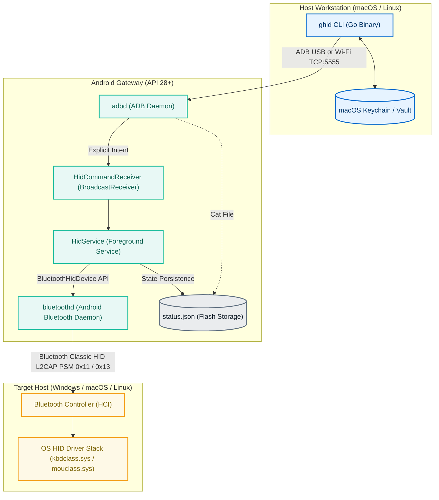

# GhostHID Architecture Specification

GhostHID turns an Android smartphone into a hardware Bluetooth Human Interface Device (HID) peripheral. It allows a host workstation or automation agent to inject keystrokes, pointer gestures, and credential sequences into a target computer.

## System Topology

The system comprises three physical or logical tiers:
1. **Host Workstation:** Runs the Go CLI (`ghid`), automation scripts, or AI agent workloads.
2. **Android Gateway Phone:** Runs the `com.sj010.ghid` app (Material 3 Compose UI + `HidService` foreground service) and handles Bluetooth HID profile communications.
3. **Target Computer:** Any computer running Windows, macOS, or Linux paired with the phone over Bluetooth Classic.



## Android Gateway Subsystem

The Android package `com.sj010.ghid` is the single shipping app. It has a launcher activity (`MainActivity`, Material 3 Expressive dashboard, Combo Studio, trackpad, and a landscape stream-deck surface), but the gateway itself never depends on the UI: `HidService` is an always-on foreground service that can be started, stopped, and commanded entirely over ADB with the screen off. A separate headless build is no longer maintained — see `docs/prompts/headless-android-app.md` if you want to code your own.

### Service Lifecycle and Notification Channel
The gateway implements `android.app.Service` as an ongoing foreground service:
- **Notification Channel:** ID `ghost_hid_gateway` with `IMPORTANCE_LOW` priority.
- **Service Type:** `ServiceInfo.FOREGROUND_SERVICE_TYPE_CONNECTED_DEVICE` for API 29+ compliance.
- **Auto-restart:** `START_STICKY` with internal restart loop if the Android system reclaims resources.

### Bluetooth HID Profile Implementation
The gateway exposes the HID profile through `android.bluetooth.BluetoothHidDevice`.

#### SDP Service Record
- **Service Name:** `GhostHID Keyboard & Mouse`
- **Description:** `Virtual HID Keyboard + Mouse Gateway`
- **Provider Name:** `Android`
- **Subclass:** `BluetoothHidDevice.SUBCLASS1_COMBO` (`0xC0` — keyboard + mouse composite)

#### HID Report Descriptor
GhostHID uses a standard composite keyboard and mouse report descriptor (ADR-002, ADR-008):

```text
Usage Page: Generic Desktop (0x01)
Usage: Keyboard (0x06)
Collection (Application)
  Report ID: 1
  Usage Page: Key Codes (0x07)
  Usage Minimum: 224, Usage Maximum: 231
  Logical Minimum: 0, Logical Maximum: 1
  Report Size: 1 bit, Report Count: 8
  Input (Data, Variable, Absolute)       -> Modifier byte (Ctrl, Shift, Alt, GUI)
  Report Count: 1, Report Size: 8 bits
  Input (Constant)                       -> Reserved padding byte (0x00)
  Usage Page: LEDs (0x08)
  Usage Minimum: 1, Usage Maximum: 5
  Report Count: 5, Report Size: 1 bit
  Output (Data, Variable, Absolute)      -> LED indicators (Num, Caps, Scroll, Compose, Kana)
  Report Count: 1, Report Size: 3 bits
  Output (Constant)                      -> LED padding bits
  Usage Page: Key Codes (0x07)
  Usage Minimum: 0, Usage Maximum: 101
  Logical Minimum: 0, Logical Maximum: 101
  Report Size: 8 bits, Report Count: 6
  Input (Data, Array)                    -> 6 simultaneous pressed keycodes
End Collection (Application)
```
Total keyboard input report size: 8 bytes.
- Byte 0: Modifiers (Bit 0: Left Ctrl, Bit 1: Left Shift, Bit 2: Left Alt, Bit 3: Left GUI/Win, Bit 4: Right Ctrl, Bit 5: Right Shift, Bit 6: Right Alt, Bit 7: Right GUI).
- Byte 1: Reserved (0x00).
- Bytes 2-7: Up to 6 simultaneous HID usage codes.

### ADB IPC and Intent Routing
The Android application defines `HidCommandReceiver` in `android/app/src/main/AndroidManifest.xml` with `exported="true"`.
The host triggers actions by sending broadcast intents through ADB:

```bash
adb shell am broadcast \
  -a com.sj010.ghid.ACTION_CMD \
  -n com.sj010.ghid/.service.HidCommandReceiver \
  --es cmd "<action>" \
  [--es <param> "<value>"]
```

Supported intent actions and parameters:
| Intent Command (`--es cmd`) | Extra Parameter | Description |
|:----------------------------|:----------------|:------------|
| `connect` | `--es address <MAC>` | Initiates Bluetooth L2CAP connection to target host |
| `disconnect` | none | Closes Bluetooth connection |
| `unpair` | `--es address <MAC>` | Invokes hidden `removeBond` reflection on bonded device |
| `register` | none | Re-registers the Bluetooth SDP application record |
| `lock` (or action `ACTION_LOCK`) | none | Dispatches `Win + L` (`cmd+ctrl+q` on macOS targets) |
| `sleep` | none | System Control Sleep (macOS targets run the sleep combo instead) |
| `type` (or action `ACTION_TYPE`) | `--es text "<string>"` | Translates ASCII characters into down/up report pairs |
| `combo` | `--es keys "<tokens>"` | Parses chord tokens and dispatches timed reports |
| `mouse` | `--es action "<token>"` | Emits mouse button or wheel reports (Report ID 2) |
| `media` | `--es key "<token>"` | Consumer-control keys: play/pause, next, prev, volup, voldown, mute |
| `raw` | `--es hex "<hex>"` `[--es id <n>]` | Sends an explicit raw report; Report ID inferred from length when omitted |
| `status` | none | Forces immediate write of current status to flash |
| `stop` | none | Cleans up connections, unregisters SDP, and kills service |

The service itself is started with no extras at all:

```bash
adb shell am start-foreground-service -n com.sj010.ghid/.service.HidService
```

### State Persistence Protocol
The service writes status snapshots to `/sdcard/Android/data/com.sj010.ghid/files/status.json` whenever connection, pairing, or registration state changes:

```json
{
  "registered": true,
  "connected": true,
  "state": "CONNECTED",
  "target": "LP-TZD-0X114650",
  "address": "38:FC:98:E8:E3:87",
  "os": "windows",
  "os_confidence": "high",
  "detection_method": "hid_led_handshake",
  "updated": "2026-03-28 14:15:22.104"
}
```

The host CLI inspects this file with `adb shell cat <path>` to verify readiness before dispatching keystrokes — it reads exactly one path and falls back to an offline status if the file is missing or malformed (no compatibility probing of legacy locations). The Android UI mirrors the passive host OS fingerprint (ADR-007) into the same `status.json`, from which it picks the OS logo, the default combo filter, and the pinned/most-used scoping.

---

## Host CLI Subsystem (`ghid`)

The host CLI is implemented in Go as a static binary. The codebase uses deep module boundaries with clear separation between interface, business logic, and transport execution.

```mermaid
flowchart TD
    subgraph UI_Layer["Presentation Layer"]
        CLIHandler["cli.App (Command Router)"]
        InteractiveTUI["tui.Model (Bubble Tea / Lip Gloss)"]
        ComboStudio["tui.ComboStudio (Interactive Macro Editor)"]
        PayloadStudio["tui.PayloadStudio (Variable & Secret Vault)"]
        QuickSendView["tui.QuickSend (Type / Raw Modal)"]
        JSONFormatter["JSON Output Serializer"]
    end

    subgraph Core_Logic["Core Gateway & Domain Layer"]
        GatewayCtrl["gateway.Controller Interface"]
        GatewayImpl["gateway.Gateway"]
        HIDEngine["hid.Actions & Unified Bracket Parser"]
        ComboStore["combos.Store (~/.config/ghid/combos.json)"]
        PayloadStore["payloads.Store (~/.config/ghid/payloads.json)"]
        ConfigStore["config.Store (~/.config/ghid/config.json)"]
        Vault["vault.Vault (macOS Keychain / In-Memory)"]
    end

    subgraph Transport_Layer["Transport & System Execution Layer"]
        ADBManager["adb.Manager"]
        Runner["adb.Runner Interface (ExecRunner)"]
        NativeKeychain["keychain.MacOSKeychain (/usr/bin/security)"]
        SubprocessOS["os/exec (Local Shell Execution)"]
    end

    CLIHandler --> InteractiveTUI
    CLIHandler --> ComboStudio
    CLIHandler --> PayloadStudio
    CLIHandler --> JSONFormatter

    InteractiveTUI --> ComboStudio
    InteractiveTUI --> PayloadStudio
    InteractiveTUI --> QuickSendView

    CLIHandler --> GatewayCtrl
    InteractiveTUI --> GatewayCtrl
    ComboStudio --> ComboStore
    PayloadStudio --> PayloadStore

    GatewayCtrl <|-- GatewayImpl
    GatewayImpl --> HIDEngine
    GatewayImpl --> ADBManager
    GatewayImpl --> Vault

    ComboStore --> HIDEngine
    PayloadStore --> Vault
    HIDEngine ..> PayloadStore : "Resolves {NAME} payload references"
    ConfigStore --> GatewayImpl

    ADBManager --> Runner
    Runner --> SubprocessOS
    Vault --> NativeKeychain
    NativeKeychain --> SubprocessOS

    classDef ui fill:#E8EAF6,stroke:#3F51B5,stroke-width:2px,color:#1A237E
    classDef domain fill:#E0F2F1,stroke:#009688,stroke-width:2px,color:#004D40
    classDef transport fill:#FFF3E0,stroke:#FB8C00,stroke-width:2px,color:#E65100
```

---

## Security Model

### Credential Handling
Automated login requires passing sensitive user passwords to the target host. To avoid storing credentials in plaintext on disk:
- On macOS, credentials are saved to the user's login Keychain using `/usr/bin/security add-generic-password -s ghost-hid -a <username> -w <password> -U`.
- Retrieval occurs in memory only when executing `ghid login`. The password is never written to log files, disk caches, or terminal logs.
- The password string is converted into a sequence of HID keycode down/up reports and passed directly over ADB. Once transmitted, the string buffer is dereferenced.

### Device Pairing and Bluetooth Authentication
- Bluetooth HID runs on standard Bluetooth Classic security mode 4 with Secure Simple Pairing (SSP).
- When pairing for the first time, both the Android phone and the target host display a matching numeric comparison passkey.
- Once paired, link keys are stored in the Android system Bluetooth keystore and the target host's operating system credentials.
- GhostHID does not accept incoming unauthenticated connection requests. The connection is initiated from the phone to a known target MAC address.

---

## Cross-Platform Host Adaptation & Vector Iconography

See [ADR-010](decisions/ADR-010-macos-and-cross-platform-gesture-adaptation.md) and [ADR-011](decisions/ADR-011-quick-send-unified-iconography-and-host-coupling.md).

### Host Target Adaptation
GhostHID supports heterogeneous environments where the target machine may run Windows, macOS, or Linux:
- **Fingerprinting & Auto-Detection**: Bluetooth device names (e.g., `Shubham’s MacBook Air`) automatically configure the initial default target OS to `macOS` (see ADR-007).
- **Dynamic Gesture Resolution**: The virtual trackpad multi-finger gesture subsystem (`TrackpadGesture.kt`) maps 3-finger and 4-finger swipes dynamically based on the current target OS:
  - *macOS*: Mission Control (`ctrl+up`), Show Desktop (`cmd+f3`), Spaces navigation (`ctrl+left`/`ctrl+right`), App Exposé (`ctrl+down`), and Minimize All (`cmd+opt+m`).
  - *Windows*: Task View (`win+tab`), Show Desktop (`win+d`), App Switching (`alt+tab`), Action Center (`win+a`), Minimize All (`win+m`), and Virtual Desktops (`ctrl+win+left`/`right`).
- **Quick Send Adapters & Device-Coupling**:
  - Quick Send placeholders and sequence parsing automatically adapt keyboard shortcut defaults (e.g. `cmd+space` on macOS vs `win+r` on Windows).
  - Quick Send OS target is strictly driven by the active or last-connected target device (`effectiveTargetOs`), removing detached manual toggle controls.
  - When no device is selected (`targetDevice == null`), Quick Send displays the Ghost mascot icon and renders the full send history.

### Canonical Vector Iconography
Generic system/laptop icons are superseded by branded vector silhouettes:
- `ic_os_apple.xml`: Canonical Apple silhouette for macOS targets.
- `ic_os_windows.xml`: Canonical 4-pane silhouette for Windows targets.
- `ic_os_linux.xml`: Canonical silhouette for Linux targets.
- Uniformly rendered via `OsGlyph(os = targetOs, modifier, tint)`.
- Combo identity uses `ComboGlyph(combo, size, tint)`: the combo's optional `emoji` metadata wins, otherwise it delegates to the target OS logo. The same emoji replaces the `[win]` / `[mac]` / `[linux]` badge in `ghid combo list` and the TUI.
- Quick Send header merges the previous toggle pill and lightning bolt into a single 44dp clover container (`ExpressiveShapes.Clover4Leaf`) holding the active `OsGlyph` or `ic_notification_ghost`.

### Inset-Aware PullDownShade Architecture
The pull-down morphing shade (`PullDownShade.kt`) computes travel distance and available surface bounds accounting for both status bar and navigation bar system insets:
`availableHeight = maxHeight - navBarBottom - 16.dp`
This ensures the bottom dock controls never overlap the Android system navigation bar or gesture pill on modern edge-to-edge displays.

### Landscape Ghost Stream Deck
Rotating the phone to landscape replaces the bottom-nav scaffold with `StreamDeckScreen`: an immersive, full-bleed surface that is its own view, not the dashboard collage. It paints eleven expressive tiles edge to edge (`StreamDeckCollage`, `streamDeckSlots()`): the upper band is slots `0..4`, so the dashboard pins (`PinnedFavoritesPolicy`) light up here automatically, and the lower band is slots `5..10` — extra deck-only slots that share the same pin store. Tapping a pinned shape runs its combo; any empty shape opens the shared favorite picker and pins into that slot. A "stream deck" label sits in the top-left corner and a slim three-dot handle lives on the middle of the left edge (`StreamDeckDrawer`). Tapping or dragging that handle slides the payload panel sideways out of the left edge over a dimmed deck; dragging it back or tapping the scrim closes it. Pills flow right-to-left so the most-used pill sits at the panel's right edge, each gets a stable silhouette from the wide-friendly subset of the catalogue, and pills are sorted by `PayloadUsageRepository` dispatch counts (most-used first), then alphabetically. Tapping one types its text or sends its raw HID report.

Every expressive silhouette in the app comes from the official `androidx.compose.material3.MaterialShapes` catalogue (Material 3 `1.5.0-beta02`); `ui/theme/ExpressiveShapes.kt` only converts those normalised `RoundedPolygon`s into Compose `Shape`s.
