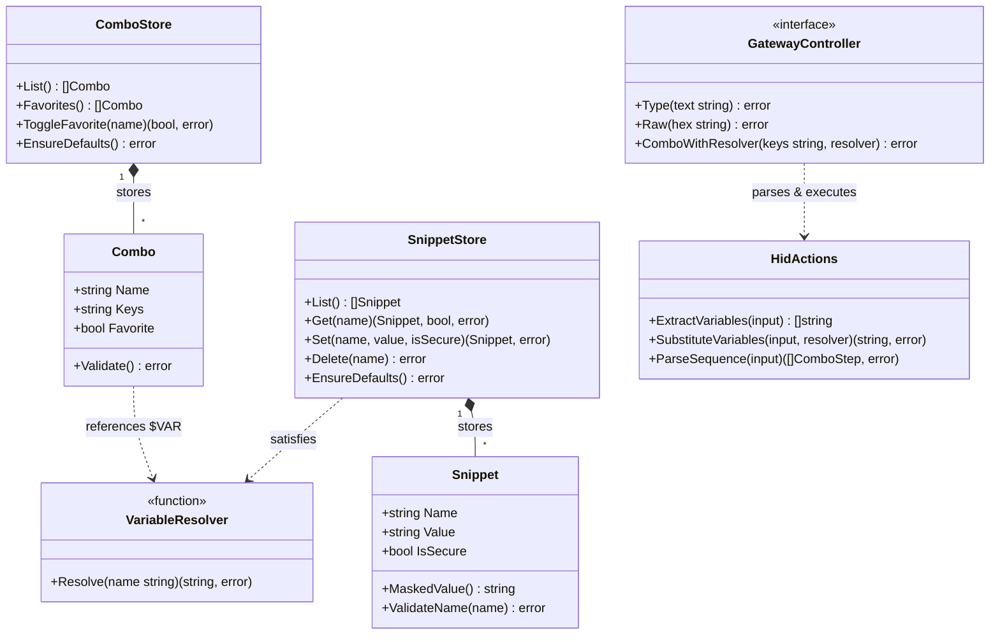

# ADR-004: Snippets Subsystem, Dynamic Combo Variables, and Unified Quick Send

## Status
Accepted

## Date
2026-10-23

## Context
Earlier iterations of GhostHID featured hardcoded credential storage for Windows login (`cfg.DefaultUser` and a single Keychain password) and separated ad-hoc typing into two distinct root-level actions: `type` (for string typing) and `raw` (for 16-hex character raw HID reports).

This design presented several limitations:
1. **Rigid Login Pipeline:** Automated unlocking was tightly coupled to a dedicated `login` action rather than leveraging the powerful Combo DSL engine. Users could not customize their unlock sequence (e.g. adding domain prefixes, smart card pin pauses, or alternate field navigations).
2. **Lack of Dynamic Macro Variables:** Chords, text sequences, and scripts could not reuse credentials or user variables without duplicating secret tokens across multiple macros.
3. **Root CLI and Menu Clutter:** Having `type` and `raw` as separate top-level dashboard commands bloated the menu, increased cognitive overhead, and duplicated input handling logic.
4. **Visibility of Primary Actions:** Frequently used macros (such as the primary login sequence) were mixed into the alphabetical or standard action list rather than highlighted for immediate one-touch dispatch.

## Decision

We replaced the legacy credential and ad-hoc typing architecture with three cohesive subsystems:

### 1. Snippets Subsystem (`internal/snippets`)
- Implement a dedicated store (`~/.config/ghid/snippets.json`) storing named string variables.
- Support both standard text snippets and hardware-encrypted secure snippets (backed by macOS Keychain using the service key `ghost-hid:snippet:<name>`).
- Ship with two default snippets out-of-the-box: `username` (plain) and `password` (secure).
- Provide full interactive management via **Snippet Studio** (`tui.SnippetStudioModel`) and CLI commands (`ghid snippets [list|get|set|delete]`).
- Mask secure snippet values in lists and UI views (`••••••••`) while decrypting only at the moment of HID injection.

### 2. Variable Substitution & Favorite Combos (`internal/hid`, `internal/combos`)
- Extend the Combo DSL parser to extract and interpolate `$NAME` and `${NAME}` variables.
- Employ the **Dependency Inversion Principle (DIP)**: `adb.Manager` and `gateway.Gateway` execute sequences through an abstract variable resolver (`func(name string) (string, error)`), completely decoupling keystroke dispatch from storage implementation.
- Introduce a `Favorite` boolean attribute on `Combo`.
- Dynamically pin favorite combos to the top of the TUI action menu with a heart icon (`❤️`) for single-key dispatch.
- Seed the default `Login` combo on first launch as a favorite:
  `ctrl+alt+del ->{1.0} esc ->{0.8} $USERNAME ->{0.8} tab ->{0.8} $PASSWORD ->{0.8} enter`
- Intercept combo execution if referenced snippets are empty: prompt the operator to populate the required variables seamlessly rather than failing.

### 3. Unified Quick Send (`ghid quick` & `StateQuickSend`)
- Completely remove `type` and `raw` from root commands in both the CLI and TUI dashboard. Do not provide backward compatibility aliases in order to maintain a clean, minimal interface.
- Replace both with **Quick Send** (`ghid quick`), placed alongside `combo` in the dashboard menu.
- **Default Behavior:** Type text strings through the virtual keyboard.
- **Switchable to Raw:** Seamlessly switch to raw HID report transmission (16-hex characters e.g. `0000040000000000`) by pressing `Tab` or `Ctrl+R` in the TUI, or passing the `--raw` (`-r`) flag / `raw:` prefix in the CLI.
- **Input Validation:** Enforce strict 16-hexadecimal (8-byte) length checks before dispatching raw reports to prevent device desync.

## Architecture & Class Interactions

## Alternatives Considered

### Retaining Backward Compatibility Aliases for `type` and `raw`
- *Pros:* Existing user scripts invoking `ghid type` or `ghid raw` would continue to work without modification.
- *Cons:* Preserves legacy surface area, clutters `--help` documentation, and dilutes the cohesive Quick Send mental model.
- *Decision:* Removed cleanly with immediate error feedback explaining `quick` usage.

### Reading Credentials via Environment Variables (`$ENV_VAR`)
- *Pros:* Common in CI/CD environments.
- *Cons:* Insecure on developer workstations; environment variables sit unencrypted in process memory and shell history, and do not integrate with OS Keychains.
- *Decision:* Dedicated `SnippetStore` with Keychain encryption for secrets.

## Consequences
- **Positive:**
  - Unified, minimal CLI and dashboard navigation.
  - Zero-touch automated login is now 100% customizable via the standard Combo Studio.
  - Secrets are encrypted at rest using macOS Keychain, while text snippets are versioned cleanly.
  - First-run experience is smooth: the user is prompted for missing credentials only when executing a macro that requires them.
- **Negative / Trade-offs:**
  - Breaking change: Scripts calling `ghid type` or `ghid raw` must migrate to `ghid quick` or `ghid quick --raw`.
