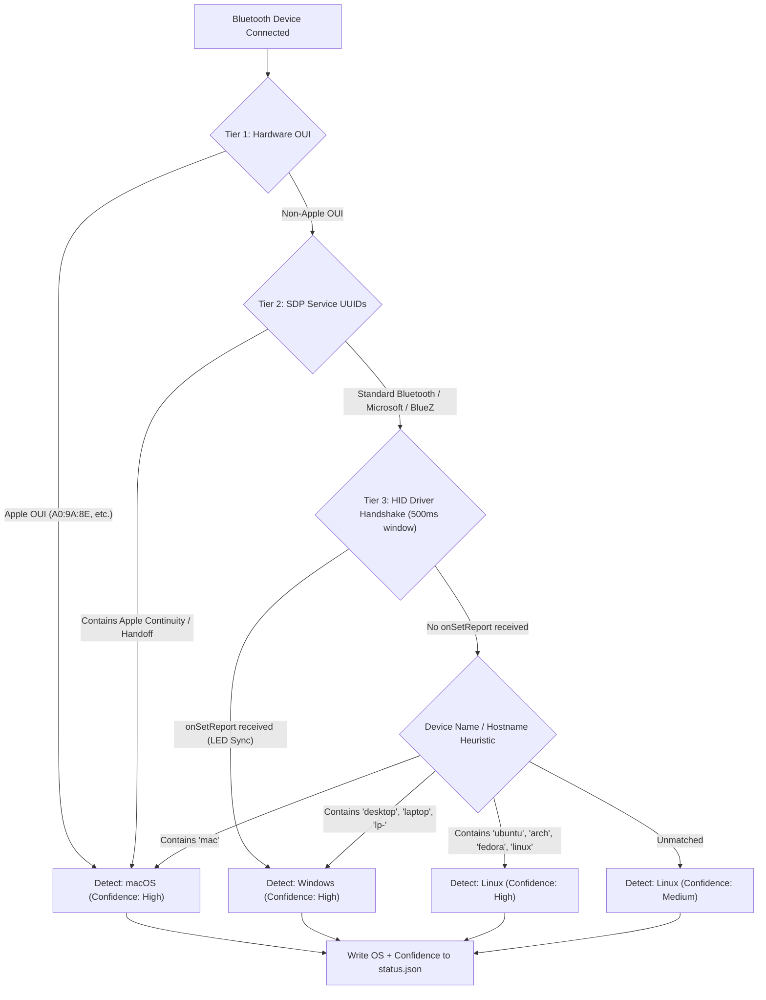

# ADR-007: Passive Host OS Fingerprinting via Bluetooth and HID Signatures

## Status
Accepted

## Date
2026-10-24

## Context
GhostHID executes key combos, macros, and navigation across different target operating systems (Windows, macOS, Linux). Each operating system has conflicting key mappings:
- GUI key: Windows/Linux `Win`/`Super` vs. macOS `Cmd`
- Modifier chord shortcuts: `Ctrl+Alt+Del` (Windows) vs. `Cmd+Opt+Esc` (macOS)
- Lock screen: `Win+L` (Windows) vs. `Cmd+Ctrl+Q` (macOS) vs. `Super+L` (Linux)
- Mouse scroll directions and sensitivity

Previously, target platform selection was manual (`ghid devices add --os windows|macos` or `~/.config/ghid/config.json`). When switching targets or working with multiple devices, manual configuration is error-prone and impedes headless agent automation.

We need an automatic, passive, robust way inside Android's `HidService` to detect the connected host operating system over Bluetooth without requiring host-side software or sending intrusive keystrokes.

## Decision
Implement a multi-tier passive fingerprinting engine in Android `HidService` utilizing three distinct Bluetooth and HID protocol signals:



### Signal 1: Hardware MAC Address OUI (Layer 1)
GhostHID runs over Bluetooth Classic (BR/EDR). Remote hosts use public hardware MAC addresses:
- **macOS:** Apple silicon and modern Intel Macs use Apple-registered IEEE OUIs (e.g., `A0:9A:8E`, `AC:DE:48`, `F0:18:98`, `BC:D1:D3`).
- **Windows / Linux:** Use PC chipset vendors (Intel `38:FC:98`, Realtek `00:E0:4C`, Qualcomm, MediaTek).

If an Apple OUI is detected, the target is classified as `macos` immediately with high confidence.

### Signal 2: SDP Service Discovery UUIDs (Layer 2)
Upon connection, Android interrogates remote SDP records via `device.getUuids()`:
- **macOS / iOS:** Exposes Apple-proprietary service UUIDs (Continuity, Apple Media Service `AMS`, Apple Notification Center `ANCS`).
- **Windows:** Exposes standard PC profile UUIDs, Microsoft Swift Pair, and never exposes Apple UUIDs.
- **Linux:** Exposes BlueZ standard daemon profiles (OBEX, A2DP Sink).

### Signal 3: HID Keyboard Driver Handshake (`onSetReport`) (Layer 3)
The most conclusive behavioural divergence occurs in the HID kernel driver handshake:
- **Windows (`kbdclass.sys` / `hidbth.sys`):** Windows automatically enforces keyboard LED synchronization. When a new keyboard is enumerated with Usage Page 8 (LEDs), Windows immediately sends an Output Report (`onSetReport`, Type 2, ID 1) with current LED state (`0x01` Num Lock, `0x02` Caps Lock, or `0x00`).
- **macOS:** Apple has no NumLock concept in macOS HID stack. macOS does not push an initial `SET_REPORT` on connection.
- **Linux (`hid-generic` / `uhid`):** The Linux kernel HID subsystem does not push initial LED state upon connection; it only sends reports when lock keys are toggled by user space.

A 500ms timer starts on connection. If `onSetReport` fires with report ID 1, the device is classified as `windows`. If the timer expires without `onSetReport` and the OUI is non-Apple, the device is classified as `linux`.

## State Propagation
The detected operating system is persisted in `status.json` on the Android device:
```json
{
  "registered": true,
  "connected": true,
  "state": "CONNECTED",
  "target": "LP-TZD-0X114650",
  "address": "38:FC:98:E8:E3:87",
  "os": "windows",
  "os_confidence": "high",
  "detection_method": "hid_led_handshake",
  "updated": "2026-10-24 17:35:00.000"
}
```

The Go gateway and CLI consume this field to:
1. Dynamically adapt combo translation (e.g. `win` mapped to `cmd` on macOS).
2. Validate OS-specific actions before dispatch.
3. Automatically configure target profiles in `ghid devices`.

## Alternatives Considered

### Active Keystroke Probing
- **Mechanism:** Send a harmless keystroke or query (e.g., test shortcut) and measure host response.
- **Rejected:** Highly intrusive. Pollutes user's active window or desktop UI, causing unwanted side effects. Passive sniffing is clean and invisible.

### Host-side Companion Daemon
- **Mechanism:** Require a background agent on Windows/Mac/Linux communicating over RFCOMM/SPP.
- **Rejected:** Defeats GhostHID's primary zero-software requirement on the target machine. Target must remain a generic, unmodified Bluetooth HID host.

### Relying Solely on Device Name (`device.getName()`)
- **Mechanism:** String match `"MacBook"` vs `"DESKTOP-"`.
- **Rejected:** Fragile. Users can rename PCs to anything (e.g. naming a Windows PC "My-Mac" or custom enterprise naming conventions). Must be used as a secondary hint, not sole source of truth.

## Consequences
- 100% passive; requires zero target software and leaves no visual trace on the target screen.
- Distinguishes macOS, Windows, and Linux reliably even if hostnames or physical keyboards change.
- `status.json` schema extended with `os` and `os_confidence` without breaking backward compatibility.
- CLI, TUI, and combo execution can dynamically adapt keys to target OS platform.

