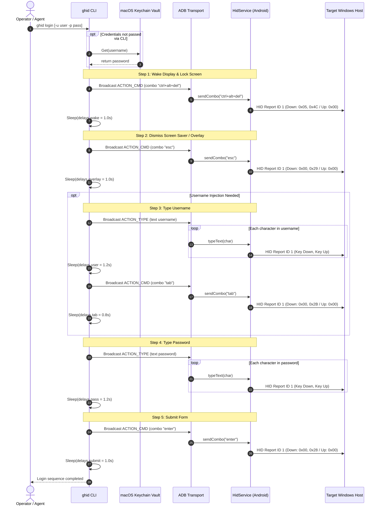
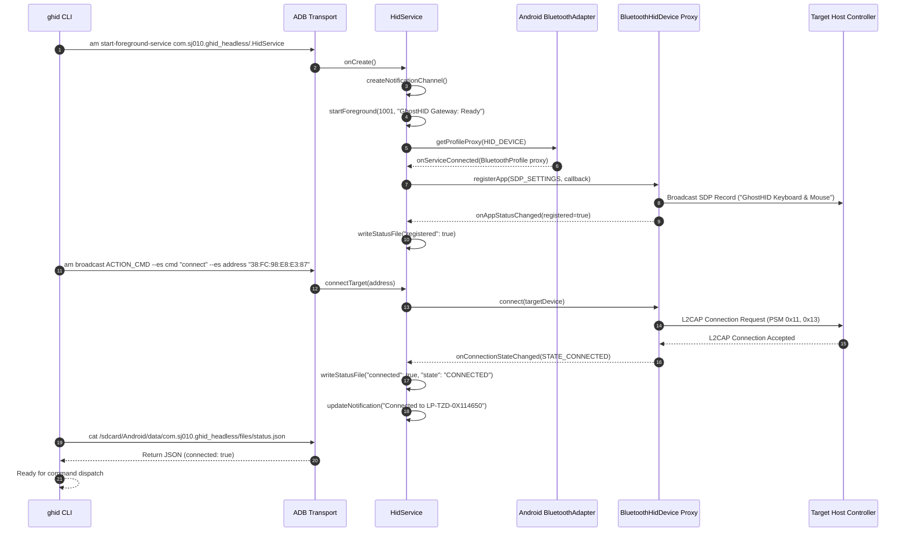
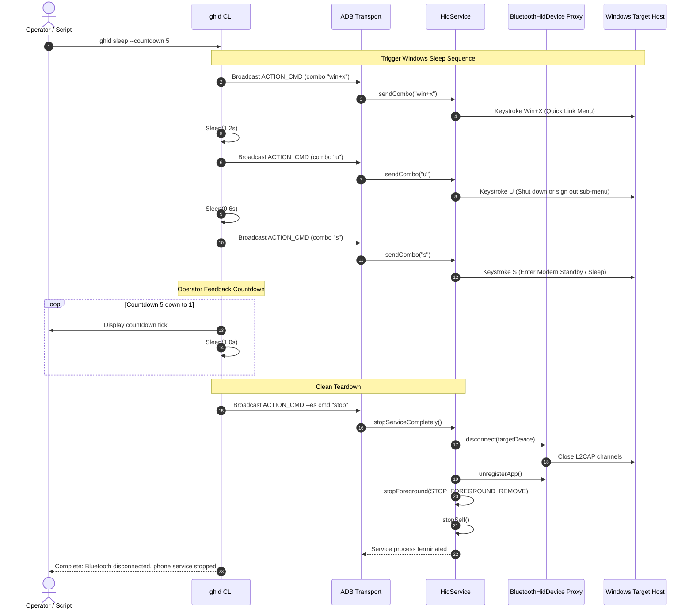
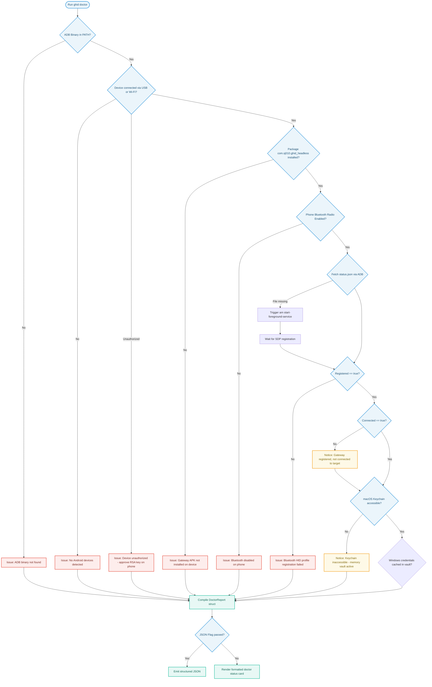
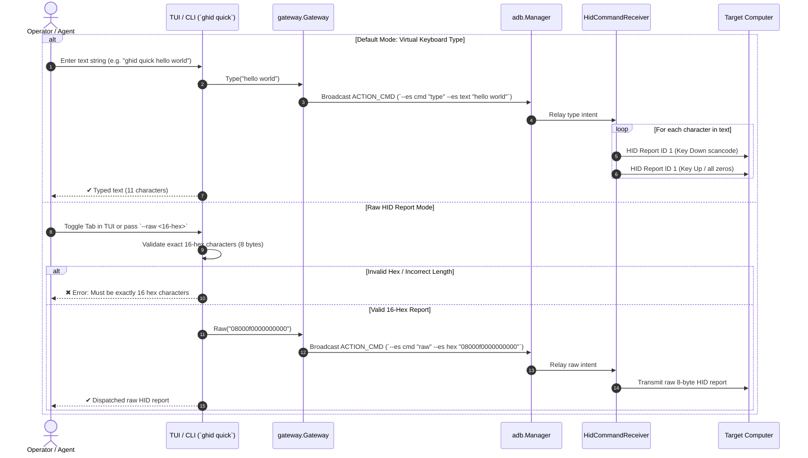

# GhostHID Execution and Lifecycle Flows

This document details the control flows and execution sequences implemented in GhostHID.

## 1. Automated Windows Unlock and Login Flow

The login flow wakes the target Windows display, clears the lock screen overlay, tabs between credential fields, types the password from the secure vault, and submits the authentication form.



### Delay Configuration Defaults
Timings are configurable in `~/.config/ghid/config.json`:
- `delays.wake`: 1.0s (Wait for display panel to power up after Ctrl+Alt+Del).
- `delays.overlay`: 1.0s (Wait for Windows lock screen swipe layer to slide away after Esc).
- `delays.user`: 1.2s (Pacing after username entry).
- `delays.tab`: 0.8s (Wait for UI focus to settle into password input field).
- `delays.pass`: 1.2s (Pacing before final submission).
- `delays.submit`: 1.0s (Cooldown after Enter).

---

## 2. Combo and Action Engine Execution

The combo engine parses chained action strings containing keyboard chords, text typing steps, and mouse gestures separated by timed transitions (`->{seconds}`).

```mermaid
flowchart TD
    Input([Input String e.g. 'win+s ->{0.7} type:rustdesk ->{0.4} enter']) --> Split[Split string on '->']
    
    subgraph StepParsing["Per-Step Parsing"]
        Step[Step Segment] --> CheckType{Prefix 'type:' or 'text:'?}
        CheckType -->|Yes| ParseText[Extract literal string]
        CheckType -->|No| CheckMouse{Matches Mouse Alias?}
        CheckMouse -->|Yes| ParseMouse[Map to MouseAction: buttons, wheel]
        CheckMouse -->|No| ParseKeys[Split on '+' and validate Windows tokens]
        
        ParseText --> StepObj[Construct ComboStep]
        ParseMouse --> StepObj
        ParseKeys --> StepObj
    end

    Split --> Step
    StepObj --> ValidateGrammar{Validate Step Sequence}
    
    ValidateGrammar -->|Invalid Token or Alias| ReturnErr[Reject: Return Validation Error]
    ValidateGrammar -->|Valid| DispatchLoop[Iterate and Execute Steps]

    subgraph Execution["Execution Loop"]
        DispatchLoop --> ExecStep{Step Type}
        ExecStep -->|Keyboard Chord| SendKbd[Send Key Down Report -> Sleep 60ms -> Send Key Up Report]
        ExecStep -->|Text String| LoopChars[Loop Chars: Map ASCII -> Send Down/Up 25ms each]
        ExecStep -->|Mouse Action| SendMouse[Send Report ID 2 -> Sleep 45ms -> Send Report ID 2 Up]
        
        SendKbd --> StepDelay[Sleep for Step Duration]
        LoopChars --> StepDelay
        SendMouse --> StepDelay
        StepDelay --> HasMore{More Steps?}
        HasMore -->|Yes| DispatchLoop
        HasMore -->|No| Complete([Execution Complete])
    end

    classDef proc fill:#E8F8F5,stroke:#1ABC9C,stroke-width:2px,color:#0E6251
    classDef dec fill:#FEF9E7,stroke:#F39C12,stroke-width:2px,color:#7D6608
    classDef err fill:#FDEDEC,stroke:#E74C3C,stroke-width:2px,color:#78281F
    classDef start fill:#EBF5FB,stroke:#3498DB,stroke-width:2px,color:#1B4F72

    class Split,ParseText,ParseMouse,ParseKeys,StepObj,DispatchLoop,SendKbd,LoopChars,SendMouse,StepDelay proc
    class CheckType,CheckMouse,ValidateGrammar,ExecStep,HasMore dec
    class ReturnErr err
    class Input,Complete start
```

### HID Timing Details
- **Keystroke down/up report interval:** 60 ms hold time before zeroing report.
- **Character typing interval:** 25 ms down report hold, 25 ms up report hold (up to 20 characters per second).
- **Mouse click interval:** 45 ms down report hold, 45 ms up report hold.
- **Double click:** Sends two click sequences separated by an 80 ms pause.

---

## 3. Bluetooth Connection and SDP Registration Flow

When the Android service starts, it must acquire the Bluetooth HID profile proxy, register its SDP service record with the local Bluetooth daemon, and initiate connection with the target laptop.



---

## 4. ACPI Sleep and Zero-Battery Teardown Sequence

When putting a target computer to sleep, GhostHID executes a clean shutdown to ensure no battery drain occurs on the phone while the laptop sleeps.



---

## 5. System Diagnostic Loop (`ghid doctor`)

The diagnostic command verifies every component in the hardware and software pipeline, pinpointing configuration errors.




---

## 6. Unified Quick Send Flow (Type vs. Raw HID)

Quick Send provides a single unified entry point for ad-hoc keystrokes and low-level hex reports. The system defaults to string typing but switches to raw 16-hex transmission when toggled or flagged.



---

## 7. Snippet Variable Resolution & Intercept Flow

When executing macros containing dynamic variable references (e.g. `$USERNAME`, `$PASSWORD`), the execution engine resolves tokens at runtime through the registered `SnippetStore`. If referenced snippets are unpopulated, the interactive dashboard prompts the user immediately instead of failing.

```mermaid
flowchart TD
    Trigger([Trigger Combo e.g. Login Macro]) --> ExtractVars[hid.ExtractVariables: Scan for $VAR and ${VAR}]
    ExtractVars --> CheckVars{Any variables in combo?}

    CheckVars -->|No| ExecDirect[Execute Keystrokes & Gestures Directly]
    CheckVars -->|Yes| QueryStore[Query snippets.Store for each variable]

    QueryStore --> CheckValues{All variables present & non-empty?}

    CheckValues -->|No (Empty Snippets)| PromptUser[Intercept: Transition to StateLoginPrompt]
    PromptUser --> CaptureInput[User fills Username & Password in TUI]
    CaptureInput --> SaveSnippets[Save text & store secret in Keychain]
    SaveSnippets --> ResumeCombo[Auto-resume and re-trigger pending combo]

    CheckValues -->|Yes| Interpolate[hid.SubstituteVariables: Replace tokens with values]
    ResumeCombo --> Interpolate
    Interpolate --> DispatchADB[adb.Manager.SendComboWithResolver]
    DispatchADB --> SendHID[Phone injects resolved HID keystrokes into host]

    classDef normal fill:#E8F8F5,stroke:#1ABC9C,stroke-width:2px,color:#0E6251
    classDef prompt fill:#FEF9E7,stroke:#F39C12,stroke-width:2px,color:#7D6608
    classDef exec fill:#EBF5FB,stroke:#3498DB,stroke-width:2px,color:#1B4F72

    class Trigger,ExtractVars,CheckVars,QueryStore,Interpolate,DispatchADB,SendHID normal
    class PromptUser,CaptureInput,SaveSnippets,ResumeCombo prompt
    class ExecDirect exec
```
